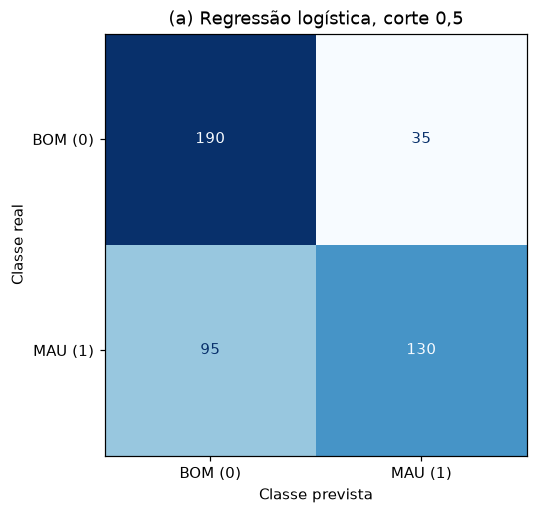
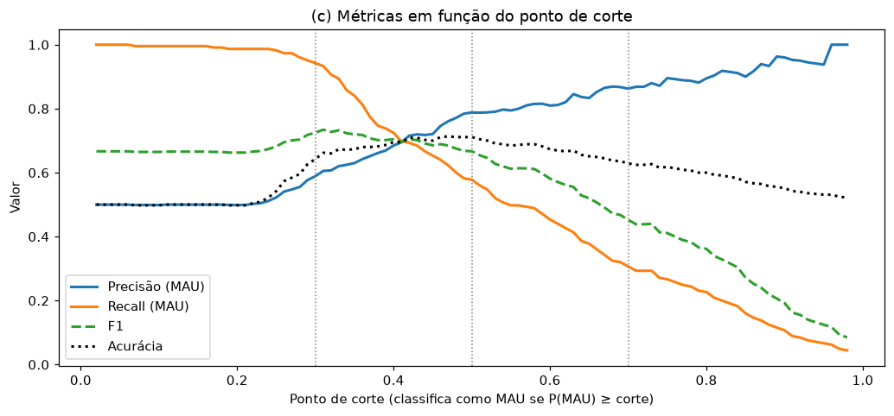
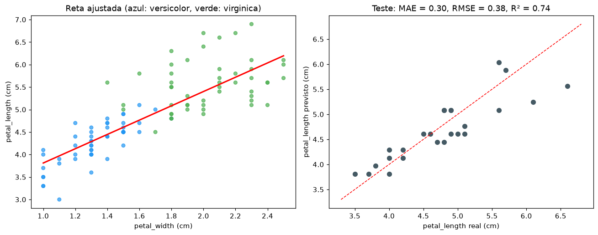
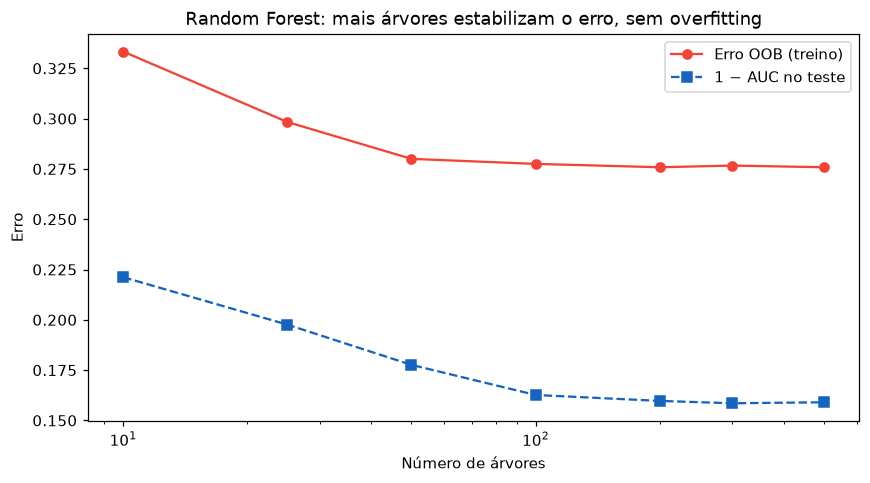
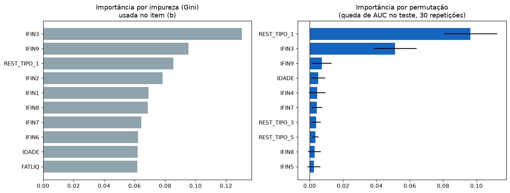
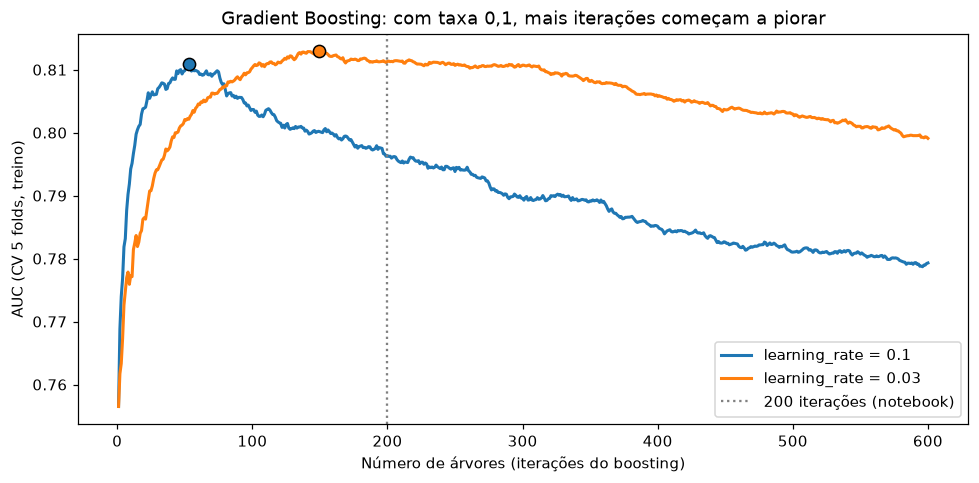
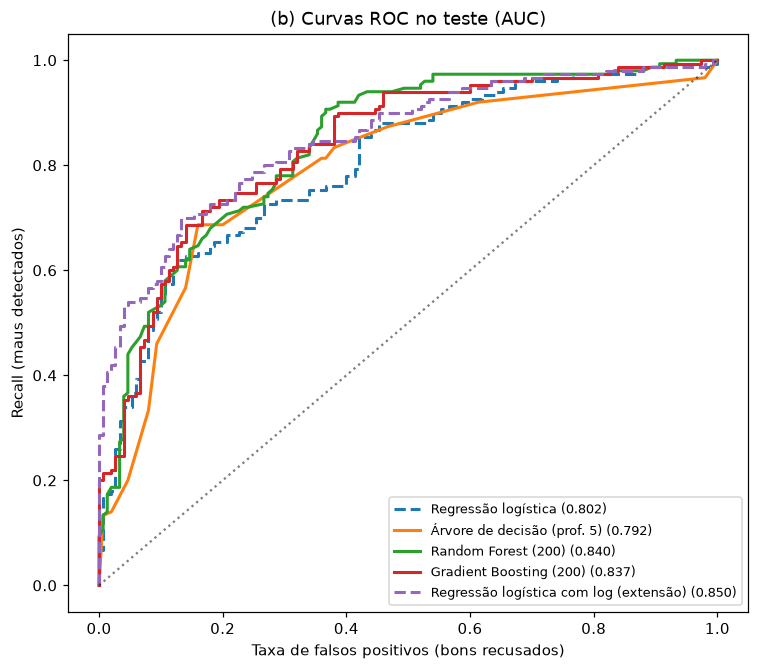

# Métricas de Avaliação e Métodos de Ensemble

Este projeto tem duas partes. A primeira trata de **como avaliar** um modelo: matriz de confusão, precisão, recall, F1, AUC e o efeito do ponto de corte, em classificação, além de MAE, RMSE e R², em regressão. A segunda trata de **ensembles**: Random Forest e Gradient Boosting, comparados com a regressão logística e a árvore de decisão na base de inadimplência PEJOTA (utilizada também em projetos anteriores).

## Principais resultados

- **A acurácia sozinha engana.** Numa base com 90% de bons pagadores, um modelo que aprova todo mundo tem 90% de acurácia e recall zero. O modelo logístico, aplicado ao mesmo cenário, tem acurácia menor (84%), mas detecta 76% dos inadimplentes.
- **O ponto de corte decide o equilíbrio entre os erros.** Baixar o corte de 0,5 para 0,3 reduz os maus aprovados de 95 para 13, ao custo de recusar 148 bons clientes em vez de 35.
- **Random Forest e Gradient Boosting atingem AUC de ~0,81 em validação cruzada,** contra 0,77 da logística padrão e 0,76 da árvore. Mas a logística com logaritmo nas variáveis, desenvolvida no projeto de regressão logística, chega ao mesmo nível (0,812), com um modelo bem mais simples de interpretar.
- **A importância por impureza (Gini) do Random Forest favorece variáveis contínuas.** Pela importância por permutação, `REST_TIPO_1` e `IFIN3` concentram praticamente todo o poder preditivo, e indicadores como `IFIN9` e `IFIN2`, altos no ranking de Gini, quase não contribuem.

## Estrutura do projeto

```
metricas-ensembles/
├── data/
│   └── base_pejota.xls            # mesma base dos projetos anteriores
├── src/
│   ├── config.py                  # caminhos, semente, divisões, cortes, nº de árvores
│   ├── data.py                    # leitura, limpeza, variáveis e divisão treino/teste
│   ├── models.py                  # pipelines: logística, árvore, Random Forest, Boosting
│   ├── metrics.py                 # todas as métricas de classificação em uma função
│   ├── q13_metricas.py            # Questão 13: métricas, cortes, logística x árvore
│   ├── q14_regressao_iris.py      # Questão 14: MAE, RMSE e R² (Iris)
│   ├── q15_random_forest.py       # Questão 15: OOB, AUC, importâncias
│   ├── q16_boosting.py            # Questão 16: Boosting, comparação, iterações
│   └── utils.py                   # salvar tabelas e figuras
├── tests/
│   └── test_metricas.py           # pré-processamento e propriedades das métricas
├── results/
│   ├── figures/                   # gráficos usados neste README
│   └── tables/                    # tabelas em CSV
├── main.py
├── requirements.txt
└── README.md
```

Este projeto acrescenta dois módulos de apoio em relação aos anteriores:

- `metrics.py` reúne todas as métricas de classificação numa única função (`metricas(y, prob, corte)`). Assim, a comparação entre modelos e entre pontos de corte usa sempre as mesmas definições.
- `models.py` monta cada modelo como um `Pipeline` com a imputação pela mediana embutida. Isso garante que a mediana seja aprendida só com o treino, inclusive dentro da validação cruzada.

---

## Questão 13: métricas de classificação

### (a) Matriz de confusão e métricas (regressão logística, corte 0,5)



| | Previsto BOM | Previsto MAU |
|---|---|---|
| **Real BOM** | VN = 190 | FP = 35 |
| **Real MAU** | FN = 95 | VP = 130 |

| Métrica | Fórmula | Valor | Leitura |
|---|---|---|---|
| Acurácia | (VP+VN)/total | 71,1% | acerta 7 de cada 10 empresas |
| Precisão | VP/(VP+FP) | 78,8% | quando aponta MAU, acerta 79% das vezes |
| Recall | VP/(VP+FN) | 57,8% | detecta só 58% dos inadimplentes |
| Especificidade | VN/(VN+FP) | 84,4% | aprova 84% dos bons pagadores |
| F1 | média harmônica de precisão e recall | 66,7% | |
| AUC | área sob a curva ROC | 0,780 | |

O modelo é **conservador em apontar inadimplentes**: quando diz MAU, costuma estar certo (alta precisão), mas deixa passar 42% dos maus pagadores (recall baixo).

### (b) Falsos negativos e falsos positivos

- **Falso negativo:** empresa inadimplente classificada como BOM. O crédito é concedido e não volta.
- **Falso positivo:** empresa adimplente classificada como MAU. O crédito é negado a quem pagaria.

**Para uma instituição de crédito, o falso negativo é o erro mais caro.** Ele gera perda direta do capital, além de custos de cobrança e de provisão. O falso positivo custa os juros que a instituição deixou de ganhar e, possivelmente, o relacionamento com o cliente. É uma perda real, mas em geral bem menor, limitada à margem da operação.

### (c) Efeito do ponto de corte

| Corte | Acurácia | Precisão | Recall | Especificidade | F1 | FN | FP |
|---|---|---|---|---|---|---|---|
| 0,3 | 64,2% | 58,9% | **94,2%** | 34,2% | **72,5%** | **13** | 148 |
| 0,5 | **71,1%** | 78,8% | 57,8% | 84,4% | 66,7% | 95 | 35 |
| 0,7 | 62,9% | **86,2%** | 30,7% | 95,1% | 45,2% | 156 | **11** |



**Para minimizar os falsos negativos, o melhor dos três cortes é 0,3.** Ele reduz os maus aprovados de 95 para 13 e detecta 94% dos inadimplentes. O preço é recusar 148 dos 225 bons clientes, ou seja, dois terços deles.

Baixar o corte sempre troca falsos negativos por falsos positivos, e o corte "certo" depende de quanto custa cada erro. Se aprovar um mau pagador custa 5 vezes mais que recusar um bom, o corte de 0,3 sai mais barato: 13×5 + 148 = 213, contra 95×5 + 35 = 510 com 0,5.

O F1 é maior em 0,3, mas a acurácia é maior em 0,5. Cada métrica privilegia um equilíbrio diferente, e por isso a escolha da métrica precisa vir do problema de negócio.

### (d) Logística × árvore de decisão

| Modelo | Acurácia | Precisão | Recall | Especificidade | AUC | FN |
|---|---|---|---|---|---|---|
| Logística (corte 0,5) | 71,1% | 78,8% | 57,8% | 84,4% | **0,780** | 95 |
| Árvore prof. 5 (corte 0,5) | 70,9% | 69,6% | **74,2%** | 67,6% | 0,762 | 58 |
| Logística (corte 0,40) | 70,0% | 69,1% | 72,4% | 67,6% | 0,780 | 62 |

Com o corte padrão, a árvore tem recall bem maior (74% contra 58%) e parece mais adequada para reduzir a inadimplência. Mas essa comparação mistura duas coisas: a qualidade do modelo e onde cada um coloca o corte. A árvore simplesmente é mais "agressiva" em apontar MAU com o corte de 0,5.

Ajustando o corte da logística para 0,40, ela passa a ter a **mesma especificidade da árvore**: recusa o mesmo número de bons clientes. Nesse ponto, os recalls ficam praticamente iguais (72,4% contra 74,2%, ou seja, 62 contra 58 maus aprovados). A AUC, que não depende do corte, é maior na logística (0,780 contra 0,762).

**Conclusão:** para minimizar a inadimplência, nenhum dos dois é claramente superior. O que importa é escolher o corte certo. A logística tem a vantagem de ordenar um pouco melhor as empresas por risco (maior AUC) e de permitir ajustar o corte de forma contínua.

### (e) Por que acurácia alta pode enganar

Um modelo que sempre prevê BOM, numa base com 90% de bons pagadores, acerta 90% das vezes sem ter aprendido nada. Para mostrar isso com dados, foi montado um subconjunto do teste com 225 BOM e 25 MAU (90/10):

| Modelo | Acurácia | Precisão | Recall | F1 | AUC |
|---|---|---|---|---|---|
| Sempre BOM | **90,0%** | 0 | **0** | 0 | 0,500 |
| Regressão logística | 83,6% | 35,2% | 76,0% | 48,1% | 0,865 |

O modelo "sempre BOM" tem acurácia maior que a logística e é inútil: não detecta nenhum inadimplente. **O recall expõe o problema** (0%), assim como o F1 e a AUC (0,5, igual ao acaso). Em bases desbalanceadas, a acurácia é dominada pela classe majoritária. As métricas calculadas sobre a classe de interesse (recall, precisão, F1) ou independentes da proporção entre classes (AUC) é que revelam se o modelo aprendeu algo.

---

## Questão 14: métricas de regressão (Iris)

Regressão linear de `petal_length` sobre `petal_width`, só com *versicolor* e *virginica* (100 flores; 75 de treino e 25 de teste).



| Métrica | Valor |
|---|---|
| Equação | petal_length = 2,22 + 1,59 × petal_width |
| MAE | 0,302 cm |
| RMSE | 0,381 cm |
| RMSE / MAE | 1,26 |
| R² no teste | 0,740 |
| R² no treino | 0,657 |
| RMSE prevendo sempre a média | 0,770 cm |

**RMSE é maior que o MAE**. O RMSE eleva os erros ao quadrado antes de tirar a média, o que dá mais peso aos erros grandes. Os dois só são iguais quando todos os erros têm o mesmo tamanho. A razão RMSE/MAE indica quão desiguais são os erros: aqui é 1,26, próxima de 1,25, que é a razão esperada para erros normais. Ou seja, não há erros extremos dominando. O maior erro do teste é de 1,04 cm.

**R² = 0,74:** a largura da pétala explica 74% da variação do comprimento entre as flores do teste. Em termos práticos, o modelo reduz o erro típico pela metade em relação a prever sempre a média (RMSE de 0,38 contra 0,77 cm). É uma relação forte, mas não "próxima de 1": sobram 26% de variação que a largura não explica, e um erro típico de ~0,3 a 0,4 cm em pétalas de 3 a 7 cm.

Com só 25 flores no teste, o R² oscila bastante conforme a divisão: no treino foi 0,66. O valor de teste mais alto é sorte da amostra, e não sinal de que o modelo generaliza "melhor que no treino".

---

## Questão 15: Random Forest

200 árvores, divisão 80/20 (1.200 treino, 300 teste).

### (a) Erro OOB e AUC

| | Valor |
|---|---|
| Erro OOB | 0,278 (acurácia OOB de 72,2%) |
| AUC no teste | **0,841** |
| Acurácia no teste | 74,3% |

O erro OOB (estimado só com o treino) e a acurácia no teste (25,7% de erro) ficam próximos, o que mostra que o OOB é uma boa estimativa do desempenho fora da amostra.



Com 10 árvores, o erro OOB é de 33%. A partir de ~100 árvores, ele se estabiliza em ~28%, e a AUC no teste também para de melhorar. **Acrescentar árvores ao Random Forest não causa overfitting:** cada árvore nova só torna a média mais estável. As 200 árvores do enunciado já estão na região estável.

### (b) Variáveis mais importantes



| Posição | Importância por impureza (Gini) | | Importância por permutação (queda de AUC) | |
|---|---|---|---|---|
| 1 | `IFIN3` | 0,130 | `REST_TIPO_1` | 0,097 |
| 2 | `IFIN9` | 0,095 | `IFIN3` | 0,051 |
| 3 | `REST_TIPO_1` | 0,086 | `IFIN9` | 0,008 |
| 4 | `IFIN2` | 0,079 | `IDADE` | 0,006 |
| 5 | `IFIN1` | 0,069 | `IFIN4` | 0,005 |

Pela importância de Gini, os indicadores financeiros dominam o top 5. Essa medida, porém, tem um viés conhecido: **favorece variáveis contínuas com muitos valores distintos**, porque elas oferecem mais pontos de divisão possíveis. Árvores profundas acabam usando essas variáveis para separar casos isolados do treino, mesmo sem relação real com o alvo. `IFIN9`, `IFIN1` e `IFIN2` têm 534, 482 e 341 valores distintos, contra 79 de `REST_TIPO_1`.

A importância por permutação mede outra coisa: quanto a AUC **no teste** cai quando os valores de uma variável são embaralhados. Por ela, o quadro é bem diferente. **`REST_TIPO_1` (desabonos do cliente) é a variável mais importante, seguida de `IFIN3`.** Todas as outras juntas contribuem pouco.

**Comentário:** o risco de inadimplência é explicado principalmente pelo **histórico de restrições recentes** (`REST_TIPO_1`) e por **um indicador de balanço** (`IFIN3`). Os demais indicadores financeiros acrescentam pouco quando essas duas variáveis já estão no modelo.

### (c) Por que o Random Forest supera uma árvore única, e o que é o erro OOB

**Random Forest × árvore única.** Uma árvore de decisão profunda tem viés baixo, mas **variância alta**: pequenas mudanças nos dados de treino produzem árvores muito diferentes. O Random Forest treina centenas de árvores, cada uma em uma amostra bootstrap (sorteio com reposição) dos dados. Em cada divisão, cada árvore só pode escolher entre um subconjunto aleatório das variáveis. Esse segundo sorteio faz as árvores ficarem menos parecidas entre si. A previsão final é a média (ou votação) das árvores. A média de muitos modelos pouco correlacionados tem variância muito menor que cada modelo isolado, e o viés continua parecido com o de uma árvore profunda. Por isso o conjunto generaliza melhor. Na base PEJOTA, a AUC sobe de 0,76 (árvore de profundidade 5) para 0,81 em validação cruzada.

**Erro OOB (out-of-bag).** Cada amostra bootstrap deixa de fora, em média, ~37% das observações, já que (1 − 1/n)ⁿ ≈ e⁻¹ ≈ 0,37. Para cada empresa do treino, existem então ~74 das 200 árvores que nunca a viram. O erro OOB é calculado prevendo cada empresa só com essas árvores. Funciona como uma validação cruzada "embutida": cada observação é avaliada por modelos que não a usaram, sem precisar separar um conjunto de validação. Aqui, o erro OOB (27,8%) ficou próximo do erro no teste (25,7%).

---

## Questão 16: Gradient Boosting e comparação final

### (a) Gradient Boosting

Com 200 árvores de profundidade 3 e taxa de aprendizado 0,1, a AUC no teste é de **0,838**.

O boosting funciona de forma diferente do Random Forest. Em vez de fazer a média de árvores independentes, ele treina árvores pequenas **em sequência**, cada uma corrigindo os erros que as anteriores deixaram. Por isso, ao contrário do Random Forest, **o boosting pode sofrer overfitting com árvores demais**:



| Taxa de aprendizado | Melhor nº de iterações (CV) | AUC CV no melhor ponto | AUC CV com 200 | AUC CV com 600 |
|---|---|---|---|---|
| 0,1 (notebook) | 53 | 0,811 | 0,796 | 0,779 |
| 0,03 | 149 | 0,813 | 0,811 | 0,799 |

Com taxa 0,1, o desempenho em validação cruzada atinge o máximo com ~50 árvores e depois cai: as 200 árvores do enunciado já estão além do ponto ideal. Com uma taxa menor, cada árvore contribui menos, o ótimo fica perto de 150 iterações e a queda posterior é mais lenta. Na prática, o número de iterações do boosting deve ser escolhido por validação (ou por *early stopping*), e não fixado.

### (b) Comparação dos modelos

No teste (300 empresas):

| Modelo | AUC | Acurácia | Recall | Precisão | F1 |
|---|---|---|---|---|---|
| Regressão logística | 0,802 | 74,3% | 60,7% | 83,5% | 70,3% |
| Árvore de decisão (prof. 5) | 0,792 | 72,7% | 81,3% | 69,3% | 74,8% |
| **Random Forest (200)** | **0,841** | 74,3% | 76,7% | 73,2% | 74,9% |
| Gradient Boosting (200) | 0,838 | **77,0%** | 73,3% | 79,1% | **76,1%** |
| *Logística com log (extensão)* | *0,850* | *76,3%* | *72,7%* | *78,4%* | *75,4%* |



**Pelos critérios do enunciado, o Random Forest teve a maior AUC no teste (0,841),** seguido de perto pelo Gradient Boosting (0,838). Com 300 empresas de teste, uma diferença de 0,003 não é significativa. Para verificar, todos os modelos foram reavaliados com validação cruzada (5 folds × 3 repetições na base inteira):

| Modelo | AUC CV | Erro padrão |
|---|---|---|
| Regressão logística | 0,770 | 0,005 |
| Árvore de decisão (prof. 5) | 0,762 | 0,006 |
| Random Forest (200) | 0,811 | 0,006 |
| Gradient Boosting (200) | 0,808 | 0,005 |
| Logística com log (extensão) | **0,812** | 0,004 |

As conclusões ficam mais claras:

1. **Os dois ensembles superam claramente a árvore única e a logística padrão** (+0,04 a +0,05 de AUC, várias vezes o erro padrão da diferença). Esse é o ganho típico dos ensembles: reduzem a variância da árvore e capturam relações não lineares que a logística padrão não captura.
2. **Random Forest e Gradient Boosting empatam.** A diferença entre eles (0,003) está dentro do erro padrão.
3. **A logística com logaritmo nas variáveis empata com os ensembles.** Parte importante da vantagem dos ensembles sobre a logística padrão vinha das caudas longas dos indicadores financeiros. As árvores lidam com isso naturalmente, porque só usam a ordem dos valores. A logística precisa da transformação. Corrigido isso, um modelo com 18 coeficientes interpretáveis tem o mesmo poder de ordenação que 200 árvores.

**Para crédito,** o Random Forest é uma escolha sólida quando o objetivo é só desempenho, com pouca necessidade de ajuste. Se for preciso explicar cada decisão (por exemplo, para justificar uma recusa de crédito), a logística com log oferece o mesmo desempenho com coeficientes e odds ratios diretos. Em qualquer caso, o ponto de corte deve ser ajustado ao custo relativo dos erros.

---

## Ferramentas

Python, scikit-learn, pandas, NumPy, Matplotlib, xlrd e pytest.
